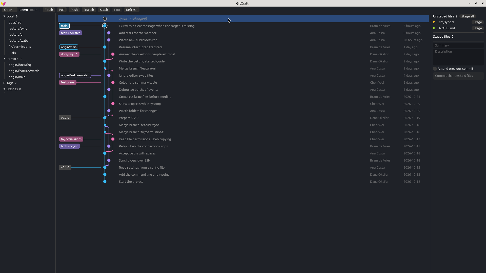

<p align="center">
  
</p>

<h1 align="center">GitCraft</h1>

<p align="center">
  <strong>A fast, open-source graphical git client, written in pure Rust.</strong><br />
  See every branch at once in a commit graph, stage single lines, commit, branch, merge, rebase
  and push, on Windows, macOS and Linux. Big repositories open instantly.
</p>

<p align="center">
  <a href="https://github.com/Lars-/gitcraft/actions/workflows/ci.yml"></a>
  <a href="#licence"></a>
  
</p>



## Fast

GitCraft reads the whole history in-process with [gitoxide](https://github.com/GitoxideLabs/gitoxide)
and only lays out and reads the rows on screen, so the size of a repository hardly matters.
Measured on [git.git](https://github.com/git/git) (85,875 commits, every branch and tag):

| | GitCraft | for comparison |
| --- | --- | --- |
| Open the whole history and lay out the graph | 0.11 s | `git rev-list --all --date-order`: 0.09 s |
| The same without a commit-graph file | 0.61 s | `git rev-list`: 0.59 s |
| Read and lay out one screen of commits | 0.1 ms | |
| Lay out 200,000 commits on 12 branches | 28 ms | |

Measured with `cargo bench` on an Intel Core i9-14900K. Every pull request runs the same
benchmarks against the main branch, and one that makes GitCraft slower does not get merged.

## What works

GitCraft is young. This is what it does today; [ROADMAP.md](ROADMAP.md) has what comes next.
Being an early version, it does not yet ask for confirmation before a hard reset, so take care
with that one.

- **Graph**: every branch, remote branch and tag in one graph, children above parents, with
  coloured lanes, branch and tag labels and the uncommitted changes on top. Arrow keys walk it.
- **Commits**: message, author, parents and the files they changed, with the diff of each file.
- **Staging**: stage or unstage files, whole hunks or single lines, then commit or amend.
- **Branches and tags**: create, check out, merge, rebase, delete, from the sidebar or a right click.
- **Commits from the graph**: check out, cherry-pick, revert, reset (soft, mixed, hard), copy the SHA.
- **Remotes**: fetch, pull and push, with how far ahead and behind you are.
- **Stashes**: stash, apply, pop and drop.

GitCraft runs your own `git` for everything that changes a repository, so your config, hooks,
credentials and commit signing work exactly as they do on the command line.

## Install

GitCraft needs [git](https://git-scm.com/downloads) on your `PATH`.

Builds for Windows, macOS and Linux (x86-64 and ARM) come with each
[release](https://github.com/Lars-/gitcraft/releases). To build it yourself, install
[Rust](https://rustup.rs) and run:

```sh
cargo install --git https://github.com/Lars-/gitcraft gitcraft
gitcraft path/to/repository
```

## Contributing

Contributions are very welcome: bug reports, ideas and pull requests. Read
[CONTRIBUTING.md](CONTRIBUTING.md) first; the short version is that every change comes with tests,
does what it does in as little code as possible, and does not make GitCraft slower.

## Licence

GitCraft is licensed under either the [MIT licence](LICENSE-MIT) or the
[Apache License 2.0](LICENSE-APACHE), at your option. Unless you say otherwise, any contribution
you submit is licensed the same way, without extra terms.

GitCraft is an independent project and is not affiliated with GitKraken or Axosoft.
